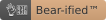

=================================================
beartype —[ the bare-metal type checker ]— assets
=================================================

Unbearably aesthetic images, styles, and other assets for general-purpose reuse
across `beartype`_ projects – including:

+------------------------------+---------------------------------------------+------------------------+
| Directory                    | Assets                                      | Creator                |
+==============================+=============================================+========================+
| `badge/ <assets badge_>`__   | |bear-ified| badge                          | |@posita|_             |
+------------------------------+---------------------------------------------+------------------------+
| `banner/ <assets banner_>`__ | **Mr. Nectar Palm,** the `beartype`_ mascot | `Felix Hildén`_        |
+------------------------------+---------------------------------------------+------------------------+
| `favicon.ico <favicon_>`__   | **Mr. Nectar Palm,**, *iconified*.          | `Felix Hildén`_ |sup1| |
+------------------------------+---------------------------------------------+------------------------+

.. # ------------------( LINKS ~ beartype                   )------------------
.. _beartype:
   https://github.com/beartype/beartype

.. # ------------------( LINKS ~ local                      )------------------
.. _assets badge:
   badge/
.. _assets banner:
   banner/
.. _favicon:
   https://raw.githubusercontent.com/beartype/beartype-assets/main/favicon.ico

.. # ------------------( LINKS ~ users                      )------------------
.. _Felix Hildén:
   https://github.com/felix-hilden
.. |@posita| replace:: **@posita**
.. _`@posita`: https://github.com/posita

.. # ------------------( DIRECTIVES ~ image                 )------------------
.. # https://docutils.sourceforge.io/docs/ref/rst/directives.html#image

.. # ------------------( FOOTNOTES ~ non-sequiturs          )------------------

|sup1| With a *tiny* bit of help from |@posita|_. |shush|

.. Whomp-whomp. :'( See <https://github.com/github/markup/issues/216>.
.. |sup1| unicode:: U+00B9
.. |shush| unicode:: U+1F92B
..
    favicon.ico was created with the following (requires ImageMagick):
      magick \
        https://raw.githubusercontent.com/beartype/beartype-assets/main/banner/logo.png \
        -crop 1500x1400+0+0 +repage \
        -background none \
        -extent 1500x1500 \
        -gravity center \
        favicon.png
      convert favicon.png \
        -background transparent \
        -define icon:auto-resize \
        -colors 256 \
        favicon.ico
      rm -f favicon.png
